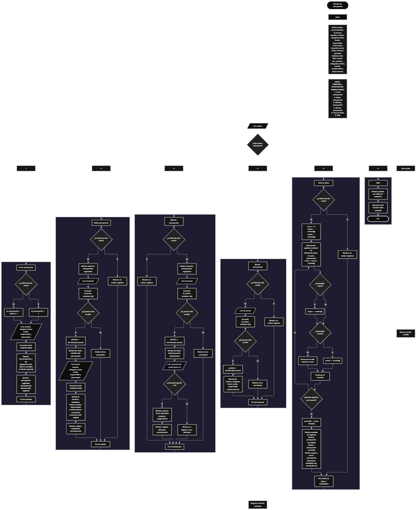

 

Este proyecto, llamado <b>afinador de presupuesto</b>, fue desarrollado en <b>python</b> como un ejercicio práctico para fortalecer la lógica de programación mediante la creación de un sistema de administración de presupuestos desde la consola. El programa cuenta con un menú principal de seis opciones que permite <b>crear, editar, eliminar, buscar y listar presupuestos</b>, además de consultar estadísticas sobre los montos registrados. Cada presupuesto almacena información como el nombre, la categoría, la fecha, el monto, el responsable y las observaciones, utilizando siete listas relacionadas para organizar los registros durante la ejecución. Durante su desarrollo se aplicaron conceptos fundamentales de programación, como variables, listas, estructuras condicionales, ciclos repetitivos, conversión de tipos de datos, búsqueda de registros y operaciones matemáticas. Este proyecto permite poner en práctica los conocimientos adquiridos en python y sirve como base para desarrollar sistemas de administración financiera más completos utilizando otros lenguajes y tecnologías.

<h2 align="center">⚙️ Funcionamiento del menú principal</h2>

### ➕ Crear presupuesto

La opción <b>1) crear presupuesto</b> permite registrar un nuevo presupuesto en el sistema. Antes de solicitar los datos, el programa comprueba si la lista <b>ids</b> está vacía mediante la condición <b>len(ids) == 0</b>. Si no existen registros, asigna el identificador inicial <b>1</b> a la variable <b>id_presupuesto</b>. En caso contrario, genera el siguiente identificador mediante la expresión <b>ids[-1] + 1</b>, tomando como referencia el último identificador almacenado. Después, solicita el <b>nombre del presupuesto, categoría, fecha, monto, responsable y observación</b>. El monto se convierte a un número decimal mediante la función <b>float()</b>. A continuación, el identificador y los seis datos se almacenan en sus respectivas listas utilizando el método <b>append()</b>. Finalmente, muestra el mensaje <b>"presupuesto registrado correctamente."</b> y presenta el identificador asignado. Los datos se mantienen en memoria durante la ejecución del programa.

### ✏️ Editar presupuesto

La opción <b>2) editar presupuesto</b> permite modificar la información de un presupuesto registrado. Primero, el programa comprueba si la lista <b>ids</b> está vacía. Si no existen registros, muestra el mensaje <b>"no existen registros."</b>. En caso contrario, presenta los presupuestos almacenados mediante un ciclo <b>for</b>, mostrando el identificador, nombre, categoría, fecha, monto, responsable y observaciones de cada registro. Después, solicita el identificador que se desea editar y convierte el valor introducido a un número entero mediante <b>int()</b>. El programa comprueba si el identificador está presente en la lista <b>ids</b>. Si existe, obtiene su posición mediante <b>ids.index(id_buscar)</b> y muestra los datos actuales del presupuesto. A continuación, solicita el nuevo nombre, categoría, fecha, monto, responsable y observación, actualizando directamente los valores de las listas correspondientes. El nuevo monto se convierte mediante <b>float()</b>, mientras que el identificador original se conserva. Finalmente, muestra el mensaje <b>"registro actualizado correctamente."</b>. Si el identificador no existe, presenta el mensaje <b>"id no encontrada."</b>.

### 🗑️ Eliminar presupuesto

La opción <b>3) eliminar presupuesto</b> permite eliminar un presupuesto registrado mediante su identificador. Primero, el programa comprueba si existen registros en la lista <b>ids</b>. Si está vacía, muestra el mensaje <b>"no existen registros."</b>. Si hay presupuestos disponibles, presenta una lista con todos sus datos y solicita el identificador del registro que se desea eliminar. El valor introducido se convierte a entero mediante <b>int()</b> y se comprueba si está presente en <b>ids</b>. Si el identificador existe, el programa obtiene su posición mediante <b>ids.index(id_buscar)</b> y muestra los datos del presupuesto seleccionado. Después, solicita confirmación mediante la pregunta <b>"¿desea eliminar este registro? (s/n):"</b>. Si la respuesta, convertida a mayúsculas mediante <b>respuesta.upper()</b>, es igual a <b>"S"</b>, elimina la posición correspondiente de las siete listas utilizando <b>pop(posicion)</b>. Finalmente, muestra el mensaje <b>"registro eliminado correctamente."</b>. Si el usuario no confirma la eliminación, presenta el mensaje <b>"el registro no fue eliminado."</b>. Si el identificador no corresponde a ningún registro, muestra <b>"id no encontrada."</b>.

### 🔎 Buscar presupuesto

La opción <b>4) buscar presupuesto</b> permite localizar un presupuesto específico mediante su identificador. Antes de comenzar, el programa comprueba si existen registros almacenados en la lista <b>ids</b>. Si no hay presupuestos registrados, muestra el mensaje <b>"no existen registros."</b>. En caso contrario, solicita el identificador que se desea buscar y convierte el valor introducido a un número entero mediante <b>int()</b>. Después, comprueba si el identificador se encuentra en la lista <b>ids</b>. Si existe, obtiene la posición correspondiente utilizando <b>ids.index(id_buscar)</b> y muestra todos los datos del presupuesto: identificador, nombre, categoría, fecha, monto, responsable y observaciones. Si no encuentra el identificador solicitado, presenta el mensaje <b>"id no encontrada."</b>. Esta operación facilita consultar un presupuesto sin necesidad de modificar o eliminar sus datos.

### 📋 Lista de datos

La opción <b>5) lista de datos</b> permite visualizar todos los presupuestos registrados y consultar estadísticas sobre sus montos. Primero, el programa comprueba si existen registros en la lista <b>ids</b>. Si no hay datos almacenados, muestra el mensaje <b>"no existen registros."</b>. Si existen presupuestos, inicializa la variable <b>suma</b> con el valor <b>0</b> y establece las variables <b>mayor</b> y <b>menor</b> con el primer monto registrado mediante <b>montos[0]</b>. A continuación, utiliza un ciclo <b>for</b> para recorrer los registros, mostrar sus datos y acumular los montos mediante la operación <b>suma += montos[i]</b>. Durante el recorrido, compara cada monto con los valores de <b>mayor</b> y <b>menor</b> para identificar el presupuesto más alto y el más bajo. Al finalizar, calcula el promedio mediante <b>suma / len(ids)</b>. Finalmente, muestra la cantidad de registros, el presupuesto acumulado, el promedio, el mayor presupuesto y el menor presupuesto. Los valores económicos se presentan redondeados a dos decimales mediante <b>round(valor, 2)</b>.

### 🚪 Salir del menú principal

La opción <b>6) salir</b> permite finalizar la ejecución del programa. Cuando el usuario selecciona esta opción, el sistema muestra el mensaje <b>"gracias por utilizar el programa."</b> y ejecuta la instrucción <b>break</b>, que interrumpe el ciclo <b>while True</b> del menú principal. De esta manera, el programa deja de mostrar las opciones y termina su ejecución. Esta operación permite cerrar el sistema de forma controlada después de realizar las tareas de administración de presupuestos.

<h2 align="center">🧠 Temas aplicados en el proyecto</h2>

### 📦 Variables

En este proyecto se utilizan variables para controlar las opciones del menú, generar identificadores, almacenar temporalmente los datos introducidos por el usuario, localizar presupuestos, actualizar registros y calcular estadísticas económicas. Cada variable cumple una función específica dentro de las operaciones del programa y permite organizar el procesamiento de la información.

🆔 **Ids:** Lista que almacena los identificadores de los presupuestos registrados.

📝 **Nombre:** Variable temporal que almacena el nombre de un presupuesto durante su creación o edición.

🏷️ **Categoria:** Variable temporal que almacena la categoría del presupuesto.

📅 **Fecha:** Variable temporal que almacena la fecha del presupuesto.

💰 **Monto:** Variable que almacena el monto económico introducido por el usuario.

👤 **Responsable:** Variable que almacena el nombre de la persona responsable del presupuesto.

📄 **Observacion:** Variable que almacena las observaciones asociadas al presupuesto.

🔢 **Id_presupuesto:** Variable que contiene el identificador asignado al nuevo presupuesto.

🔎 **Id_buscar:** Variable que almacena el identificador introducido para localizar un registro.

📍 **Posicion:** Variable que indica el índice del presupuesto encontrado dentro de las listas.

📊 **Suma:** Variable que acumula los montos de todos los presupuestos registrados.

📈 **Mayor:** Variable que almacena el monto más alto encontrado durante el recorrido.

📉 **Menor:** Variable que almacena el monto más bajo encontrado durante el recorrido.

➗ **Promedio:** Variable que almacena el promedio de los montos registrados.

### 🗃️ Listas

En este proyecto se utilizan siete listas relacionadas para almacenar los datos de cada presupuesto. Todas las listas mantienen la correspondencia de sus registros mediante el mismo índice. Por ejemplo, la información ubicada en la posición <b>0</b> de cada lista pertenece al mismo presupuesto. Esta organización permite crear, editar, buscar, mostrar y eliminar registros utilizando la posición correspondiente en cada lista. A diferencia de los arreglos de tamaño fijo, las listas de python pueden aumentar o disminuir su longitud durante la ejecución del programa.

🆔 **Ids:** Almacena los identificadores únicos de los registros mientras permanecen en la lista.

📝 **Nombres:** Almacena los nombres de los presupuestos.

🏷️ **Categorias:** Almacena las categorías de los presupuestos.

📅 **Fechas:** Almacena las fechas asociadas a cada presupuesto.

💰 **Montos:** Almacena los valores económicos de los presupuestos como números decimales.

👤 **Responsables:** Almacena los responsables de cada presupuesto.

📄 **Observaciones:** Almacena las observaciones adicionales de cada registro.

### 🔀 Estructuras condicionales

En este proyecto se utilizan las estructuras <b>if, elif y else</b> para controlar las operaciones del menú y determinar qué instrucciones deben ejecutarse según la opción seleccionada. También permiten comprobar si existen registros antes de realizar una operación, verificar si un identificador se encuentra en la lista, decidir si un presupuesto debe eliminarse después de la confirmación del usuario y comparar los montos para identificar el mayor y el menor. Estas condiciones permiten que el programa responda de acuerdo con los datos disponibles y las decisiones introducidas durante la ejecución.

### 🔄 Estructuras repetitivas

El programa utiliza los ciclos <b>while</b> y <b>for</b> para repetir instrucciones y recorrer los registros almacenados. El ciclo <b>while True</b> mantiene activo el menú principal hasta que se selecciona la opción de salida y se ejecuta <b>break</b>. Por otro lado, los ciclos <b>for</b> permiten mostrar todos los presupuestos durante las operaciones de edición y eliminación, así como recorrer los registros para calcular las estadísticas de los montos. Estas estructuras facilitan la ejecución repetida de operaciones sin necesidad de escribir instrucciones independientes para cada registro.

### 🎯 Selección de opciones

El programa utiliza una estructura condicional formada por <b>if, elif y else</b> para determinar qué operación corresponde a la opción introducida por el usuario. Las opciones de texto <b>"1", "2", "3", "4", "5" y "6"</b> permiten ejecutar las funciones de creación, edición, eliminación, búsqueda, listado de datos y salida, respectivamente. Cuando el valor introducido no coincide con ninguna opción disponible, se ejecuta el bloque <b>else</b> y se muestra el mensaje <b>"opción inválida."</b>.

### 🔢 Conversión de tipos de datos

En este proyecto se utilizan las funciones <b>int()</b> y <b>float()</b> para convertir los datos introducidos mediante <b>input()</b> a los tipos necesarios para realizar las operaciones. La función <b>int()</b> convierte el identificador introducido durante la búsqueda, edición o eliminación a un número entero. Por su parte, <b>float()</b> convierte el monto del presupuesto a un número decimal, permitiendo acumular los valores y realizar operaciones matemáticas como la suma y el promedio. El programa no incluye un manejo de errores para entradas que no puedan convertirse a los tipos solicitados.

### 🔍 Búsqueda de registros

Para localizar un presupuesto, el programa utiliza el operador <b>in</b> para comprobar si el identificador introducido está presente en la lista <b>ids</b>. Cuando existe una coincidencia, utiliza el método <b>index()</b> para obtener la posición del registro. Esta posición permite acceder a los datos relacionados en las listas <b>nombres, categorias, fechas, montos, responsables y observaciones</b>. De esta forma, el programa puede mostrar o actualizar la información correspondiente al presupuesto seleccionado.

### 🛠️ Métodos de listas

El programa utiliza diferentes métodos y operaciones de listas para administrar los presupuestos. El método <b>append()</b> agrega los nuevos identificadores y datos al final de sus respectivas listas. El método <b>index()</b> permite obtener la posición de un identificador encontrado. El método <b>pop()</b> elimina el elemento ubicado en la posición seleccionada durante la eliminación de un presupuesto. También se utiliza el acceso mediante índices, por ejemplo <b>montos[0]</b>, para consultar el primer monto y establecer los valores iniciales de las estadísticas.

### 📊 Estadísticas económicas

En la opción de listado se utilizan operaciones aritméticas y comparaciones para obtener información general de los presupuestos registrados. La variable <b>suma</b> acumula todos los montos; la variable <b>promedio</b> divide el total acumulado entre la cantidad de registros; y las variables <b>mayor</b> y <b>menor</b> permiten identificar los montos máximo y mínimo mediante comparaciones sucesivas. Finalmente, la función <b>round()</b> redondea los resultados a dos decimales para facilitar su presentación. Estas estadísticas proporcionan una visión general de los valores económicos almacenados en el sistema.

<h2 align="center">¿Cómo se implementaron las operaciones crud en el proyecto?</h2>

Las operaciones <b>crud</b> se implementaron mediante las opciones del menú principal para administrar los presupuestos registrados. La operación <b>crear</b> corresponde a <b>crear presupuesto</b>, donde se solicita la información y se agrega a las listas mediante <b>append()</b>. La operación <b>leer</b> se realiza mediante <b>buscar presupuesto</b> y <b>lista de datos</b>, que permiten consultar un registro específico o visualizar todos los presupuestos junto con sus estadísticas. La operación <b>actualizar</b> corresponde a <b>editar presupuesto</b>, donde se localiza un registro y se sustituyen sus datos. Por último, la operación <b>eliminar</b> se realiza mediante <b>eliminar presupuesto</b>, que solicita confirmación y utiliza <b>pop()</b> para quitar el registro de las siete listas. Estas operaciones permiten administrar los datos durante la ejecución del programa, sin almacenarlos de forma permanente en archivos o bases de datos.

<h2 align="center">Diagrama de flujo del proyecto</h2>

<h2 align="center">🛡️ Validaciones del programa</h2>

### 📭 No existen registros

Esta comprobación se utiliza en las opciones de <b>editar, eliminar, buscar y lista de datos</b>. El programa verifica si la lista <b>ids</b> está vacía mediante la condición <b>len(ids) == 0</b>. Si no hay presupuestos almacenados, muestra el mensaje <b>"no existen registros."</b> y evita continuar con las instrucciones que necesitan acceder a un presupuesto existente. Esta comprobación también impide que la opción de estadísticas intente obtener el primer monto mediante <b>montos[0]</b> cuando la lista está vacía.

### 🔎 Identificador no encontrado

Esta comprobación se utiliza en las opciones de <b>editar, eliminar y buscar presupuesto</b>. Después de solicitar el identificador, el programa comprueba si el valor introducido se encuentra en la lista <b>ids</b>. Si existe, obtiene la posición correspondiente mediante <b>ids.index(id_buscar)</b> y continúa con la operación solicitada. Si no existe, muestra el mensaje <b>"id no encontrada."</b>. Esta comprobación evita intentar acceder a la posición de un registro que no se encuentra almacenado.

### ❓ Confirmación de eliminación

Durante la opción <b>eliminar presupuesto</b>, el programa solicita confirmación antes de borrar los datos del registro seleccionado. La condición <b>respuesta.upper() == "S"</b> permite aceptar la confirmación tanto si el usuario introduce la letra <b>s</b> como si introduce <b>S</b>. Si la condición se cumple, se elimina la posición correspondiente de las siete listas. Si la respuesta es diferente de <b>"S"</b>, el programa conserva el registro y muestra el mensaje <b>"el registro no fue eliminado."</b>. No se comprueba que la respuesta sea exclusivamente <b>s</b> o <b>n</b>; cualquier otra entrada también cancela la eliminación.

### ⚠️ Opción inválida

El menú principal incluye un bloque <b>else</b> que se ejecuta cuando la opción introducida no coincide con los valores disponibles entre <b>"1"</b> y <b>"6"</b>. En ese caso, el programa muestra el mensaje <b>"opción inválida."</b> y vuelve a presentar el menú en la siguiente iteración del ciclo <b>while True</b>. Esta condición permite informar al usuario cuando selecciona una opción que no está definida en el programa.

### 🔢 Conversión de datos numéricos

El programa utiliza <b>int()</b> para convertir los identificadores introducidos durante las operaciones de edición, eliminación y búsqueda, y <b>float()</b> para convertir los montos durante la creación y edición de presupuestos. Sin embargo, no incluye estructuras <b>try-except</b> para controlar los errores que se producen cuando el usuario introduce un valor no numérico. Por este motivo, introducir letras u otros valores incompatibles con las conversiones puede interrumpir la ejecución del programa. Tampoco se comprueba que los montos sean positivos ni que las fechas tengan un formato específico.

### 🆔 Generación de identificadores

Al crear un presupuesto, el programa asigna el identificador <b>1</b> cuando no existen registros. Si hay presupuestos almacenados, utiliza la expresión <b>ids[-1] + 1</b> para generar el siguiente identificador a partir del último elemento de la lista. Como el programa no mantiene un contador independiente ni utiliza un almacenamiento permanente, si se elimina el último registro, el identificador de ese presupuesto puede volver a utilizarse en una creación posterior. Esta característica corresponde al funcionamiento actual del código.

### 💾 Almacenamiento temporal

Los datos se guardan en las listas de python y permanecen disponibles mientras el programa está en ejecución. Sin embargo, el código no utiliza archivos, bases de datos ni otros mecanismos de persistencia. Por lo tanto, cuando finaliza la ejecución, los presupuestos almacenados en memoria dejan de estar disponibles. Esta característica debe tenerse en cuenta al utilizar el programa para administrar información económica.

<h2 align="center">🎯 Objetivo del proyecto</h2>

El objetivo principal de este proyecto es fortalecer la <b>lógica de programación</b> mediante el desarrollo de un sistema de administración de presupuestos en <b>python</b>. A través de su construcción se busca aplicar los conocimientos adquiridos sobre variables, listas, estructuras condicionales, ciclos repetitivos, conversión de tipos de datos, métodos de listas y operaciones matemáticas. Además, el proyecto permite comprender cómo registrar, consultar, modificar y eliminar información, así como calcular estadísticas básicas a partir de los montos almacenados. De esta manera, se establece una base para desarrollar aplicaciones de administración financiera más completas, incorporando posteriormente validaciones adicionales y mecanismos de almacenamiento permanente.

